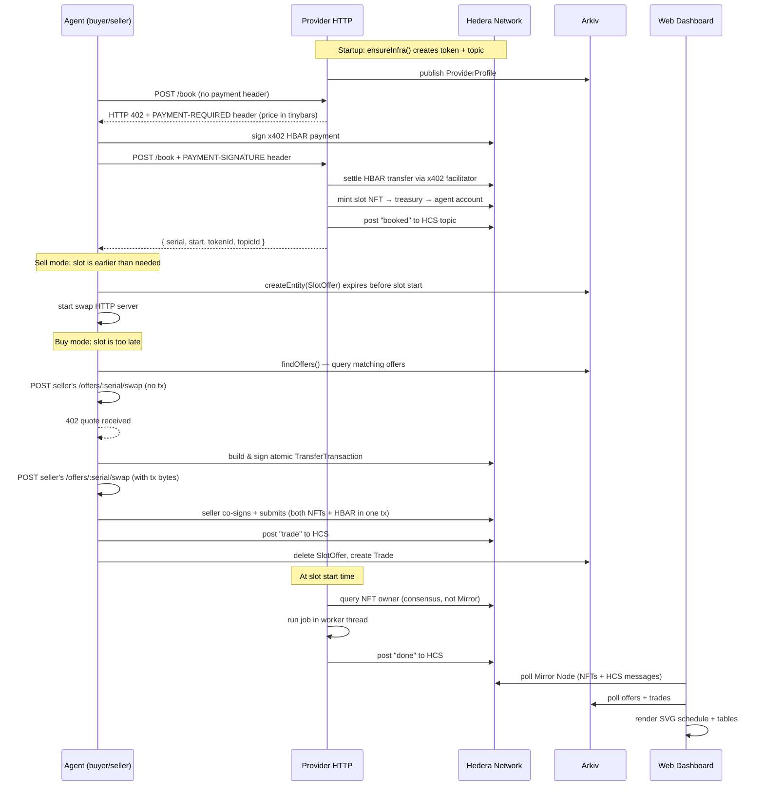

# Dani.ai (agent-hedera-arkiv) — Deep Dive
---

## 1. What Is This Project?

**Dani.ai** is a decentralized **compute-slot marketplace** where:

- A **Provider** sells time-boxed execution slots as **NFTs** on the Hedera Token Service (HTS).
- **Agents** buy those slots (paying HBAR via the x402 HTTP payment protocol) and submit jobs to be run when their slot starts.
- If an agent's slot is too late for its own deadline, it can **swap** its slot with an earlier one listed on **Arkiv** (a decentralized queryable data store), atomically exchanging both NFTs + HBAR in a single Hedera transaction.
- A **web dashboard** (read-only, no keys) lets anyone watch the schedule, open offers, completed trades, and the signed on-chain log in real time.

The three external pillars are:
| Pillar | Role |
|--------|------|
| **Hedera** (testnet) | NFT ownership (HTS), HBAR payments, consensus log (HCS) |
| **Arkiv** | Off-chain queryable index — provider profile, slot offers, trade records |
| **x402** | HTTP 402 payment-channel protocol; both HBAR booking payments and atomic swap quoting use it |

---

## 2. Monorepo Structure

```
agent-hedera-arkiv-main/
├── packages/
│   ├── shared/      ← shared TypeScript library used by all packages
│   ├── provider/    ← HTTP server: sells slots, runs jobs
│   ├── agent/       ← CLI: books slots, sells or buys them
│   └── web/         ← Vite SPA: live market dashboard (no keys)
├── spikes/          ← standalone proof-of-concept scripts
├── .env             ← secrets (never committed)
└── .env.example     ← template
```

---

## 3. Package Breakdown

### 3a. `packages/shared` — Shared Library

The backbone. Every other package imports from `@qy/shared`. Modules:

| File | Purpose |
|------|---------|
| [`env.ts`](file:///c:/Users/ayush/OneDrive/Desktop/agent-hedera-arkiv/agent-hedera-arkiv-main/packages/shared/src/env.ts) | Loads `.env`; `need(name)` throws if a var is missing; `role(name)` reads `NAME_ID` + `NAME_KEY` |
| [`hedera.ts`](file:///c:/Users/ayush/OneDrive/Desktop/agent-hedera-arkiv/agent-hedera-arkiv-main/packages/shared/src/hedera.ts) | Hedera SDK helpers: `hederaClient`, `parseKey` (DER or raw ECDSA), Mirror Node queries, NFT metadata encode/decode, `waitForOwner` |
| [`arkiv.ts`](file:///c:/Users/ayush/OneDrive/Desktop/agent-hedera-arkiv/agent-hedera-arkiv-main/packages/shared/src/arkiv.ts) | Arkiv SDK schemas (`ProviderProfile`, `SlotOffer`, `Trade`), `arkivReader`/`arkivWriter`, `offerFilter`, `findOffers` |
| [`auth.ts`](file:///c:/Users/ayush/OneDrive/Desktop/agent-hedera-arkiv/agent-hedera-arkiv-main/packages/shared/src/auth.ts) | ECDSA request signing/verification for the HTTP API (`signRequest` / `verifyRequest`); replays are blocked with a 60-second window |
| [`hcs.ts`](file:///c:/Users/ayush/OneDrive/Desktop/agent-hedera-arkiv/agent-hedera-arkiv-main/packages/shared/src/hcs.ts) | `postEvent` — signs and submits a typed `HcsEvent` to an HCS topic |
| [`http.ts`](file:///c:/Users/ayush/OneDrive/Desktop/agent-hedera-arkiv/agent-hedera-arkiv-main/packages/shared/src/http.ts) | Tiny home-made JSON router (`serve(port, routes)`) |
| [`job.ts`](file:///c:/Users/ayush/OneDrive/Desktop/agent-hedera-arkiv/agent-hedera-arkiv-main/packages/shared/src/job.ts) | `Job` type (`kind: "cpu"`, `seconds`, `label`), `parseJob`, `jobHash` (sha256 over canonical field order) |
| [`swap.ts`](file:///c:/Users/ayush/OneDrive/Desktop/agent-hedera-arkiv/agent-hedera-arkiv-main/packages/shared/src/swap.ts) | `buildSwap` (buyer-side) and `checkSwap` (seller-side) for atomic NFT+HBAR TransferTransactions |
| [`x402.ts`](file:///c:/Users/ayush/OneDrive/Desktop/agent-hedera-arkiv/agent-hedera-arkiv-main/packages/shared/src/x402.ts) | `hbarPayer` (x402 client) and `postPaid` (auto-handles 402 → pay → retry) |

---

### 3b. `packages/provider` — The Slot Server

**Entry:** [`packages/provider/src/index.ts`](file:///c:/Users/ayush/OneDrive/Desktop/agent-hedera-arkiv/agent-hedera-arkiv-main/packages/provider/src/index.ts)

#### What it does on startup
1. Calls `ensureInfra` ([`chain.ts`](file:///c:/Users/ayush/OneDrive/Desktop/agent-hedera-arkiv/agent-hedera-arkiv-main/packages/provider/src/chain.ts)) — creates the HTS NFT token (`QYSLOT`) and HCS topic on first run; loads IDs from `data/provider/infra.json` on subsequent runs.
2. Rebuilds the in-memory slot schedule from all existing NFTs on the Mirror Node.
3. Loads pending jobs from `data/provider/jobs.json` ([`store.ts`](file:///c:/Users/ayush/OneDrive/Desktop/agent-hedera-arkiv/agent-hedera-arkiv-main/packages/provider/src/store.ts)).
4. Publishes (or refreshes) its **ProviderProfile** entity on Arkiv so agents can discover it.
5. Starts the HTTP server.

#### HTTP routes
| Route | Description |
|-------|-------------|
| `POST /book` | x402-gated booking. Without `PAYMENT-SIGNATURE` → returns HTTP 402 with price. With a valid payment → verifies HBAR, mints one slot NFT to the buyer, posts `booked` to HCS. Price doubles for every fully-booked time window (exponential capacity pricing). |
| `POST /bind` | Let an account that already holds a slot replace its pending job. No payment needed. |

#### Slot dispatch
- Each slot's start time is registered as a `setTimeout`.
- When it fires: looks up the NFT owner via consensus (not Mirror, to catch last-second swaps), runs the pending job in a worker thread ([`runner.ts`](file:///c:/Users/ayush/OneDrive/Desktop/agent-hedera-arkiv/agent-hedera-arkiv-main/packages/provider/src/runner.ts)), posts `done` to HCS.
- The worker is **force-terminated** 1.5 seconds before the slot ends, so jobs can never bleed into the next slot.

#### CPU Job simulation
The `cpu` job type hashes a seed with SHA-256 in a tight loop for `job.seconds` seconds inside a Node.js worker thread. The result digest proves execution happened. This is a **demo/simulation** — a real system would run actual compute workloads.

---

### 3c. `packages/agent` — The Agent CLI

**Entry:** [`packages/agent/src/index.ts`](file:///c:/Users/ayush/OneDrive/Desktop/agent-hedera-arkiv/agent-hedera-arkiv-main/packages/agent/src/index.ts)

Runs in two modes selected by a positional argument:

#### `sell` mode (flexible agent — has time to spare)
1. Books a slot from the provider via x402 (`POST /book`).
2. If the slot already meets its own deadline → does nothing and exits.
3. Otherwise, publishes a `SlotOffer` entity on Arkiv (expires 15 s before the slot starts).
4. Starts an HTTP server at `--port` with a **swap endpoint** (`POST /offers/:serial/swap`):
   - **Without** `body.tx` → returns a 402-shaped quote (custom `qy-atomic-swap` scheme).
   - **With** `body.tx` (buyer-signed swap bytes) → validates with `checkSwap`, co-signs, submits; logs the trade to HCS and Arkiv.

#### `buy` mode (urgent agent — deadline is tight)
1. Books a slot.
2. If the slot already meets the deadline → exits.
3. Queries Arkiv with `findOffers` for cheaper/earlier slots that meet both sides' deadlines.
4. For each matching offer: contacts the seller's swap endpoint, gets a quote, builds and signs the atomic swap transaction, sends the bytes back to the seller to co-sign and submit.

#### Security model
- Every HTTP request to `/book` and `/bind` carries a **cryptographic signature** (`signRequest`) over `action|account|subject|timestamp` using the sender's Hedera ECDSA key.
- The provider verifies it against the account's on-chain public key (Mirror Node).
- Swap transactions are built by the buyer, verified field-by-field by the seller (`checkSwap`), so neither side can sneak in extra transfers.

---

### 3d. `packages/web` — Live Dashboard (Read-Only)

**Entry:** [`packages/web/src/main.ts`](file:///c:/Users/ayush/OneDrive/Desktop/agent-hedera-arkiv/agent-hedera-arkiv-main/packages/web/src/main.ts) — Vite SPA, no backend, no keys.

Refreshes every **6 seconds** by polling:
- **Mirror Node** for all slot NFTs + HCS topic messages
- **Arkiv** for live `SlotOffer` and `Trade` entities

#### UI sections
| Section | Shows |
|---------|-------|
| **Schedule** | SVG timeline of slots per worker. Color = owner. Arcs = swaps. Status = waiting / running / ran / killed |
| **Slots for sale** | Live Arkiv `qy_offer` table with seller authorship check |
| **Run the buyer's query** | Interactive form to simulate the exact Arkiv query a buying agent would run |
| **Trades** | Completed `qy_trade` records with HashScan links |
| **Signed log** | Last 30 HCS messages with ECDSA signature verification in-browser |

---

## 4. Arkiv Data Schemas

Three named schemas (defined in [`shared/src/arkiv.ts`](file:///c:/Users/ayush/OneDrive/Desktop/agent-hedera-arkiv/agent-hedera-arkiv-main/packages/shared/src/arkiv.ts)):

```
ProviderProfile (qy_provider)
  provider      str indexed    — Hedera account id
  token_id      str            — HTS NFT token
  topic_id      str            — HCS log topic
  slot_seconds  u64            — slot duration
  booking_url   str            — HTTP endpoint

SlotOffer (qy_offer)
  provider      str indexed
  slot_serial   u64 indexed
  slot_start    u64 indexed
  latest_ok_start u64 indexed  — seller's deadline - slot_seconds
  min_price     u64 indexed    — tinybars
  seller        str
  endpoint      str            — seller's swap HTTP endpoint
  job_hash      str

Trade (qy_trade)
  provider      str indexed
  seller_serial u64 indexed
  buyer_serial  u64 indexed
  price         u64 indexed
  swap_tx       str            — single atomic Hedera transaction id
  hcs_seq       str
```

---

## 5. HCS Event Types

All events are posted to the topic signed by the sender (verified on-chain key):

| Event | Emitted by | Meaning |
|-------|-----------|---------|
| `booked` | Provider | New slot NFT minted and paid for |
| `bound` | Provider | Agent updated its pending job |
| `dispatch` | Provider | Slot's start time reached; job fired (or idled) |
| `done` | Provider | Job finished or was killed |
| `trade` | Seller | Atomic swap settled on Hedera |
| `refund` | Provider | Payment received but minting failed; HBAR returned |

---

## 6. Full System Workflow



---

## 7. How to Run

### Prerequisites
- **Node.js** ≥ 20 and **pnpm** 11.x
- A testnet account at [portal.hedera.com](https://portal.hedera.com) (ECDSA key type)
- A free API key from [hub.arkiv.network/access-keys](https://hub.arkiv.network/access-keys)
- tGLM faucet tokens at [hub.arkiv.network/faucet](https://hub.arkiv.network/faucet)

### Step-by-step

#### 1. Install dependencies
```powershell
cd agent-hedera-arkiv-main
pnpm install
```

#### 2. Configure `.env`
Edit [`.env`](file:///c:/Users/ayush/OneDrive/Desktop/agent-hedera-arkiv/agent-hedera-arkiv-main/.env) (already exists). Fill in:
```env
HEDERA_OPERATOR_ID=0.0.xxxx
HEDERA_OPERATOR_KEY=<your ECDSA private key>
ARKIV_ACCESS_KEY=<from hub.arkiv.network>
X402_FACILITATOR_URL=https://api.testnet.blocky402.com
```

#### 3. Create testnet sub-accounts
```powershell
pnpm setup:accounts
```
This script creates **PROVIDER, TREASURY, AGENT_A, AGENT_B, AGENT_C** accounts funded from your operator account and **appends** their IDs and keys to `.env`. Re-running is safe.

> [!IMPORTANT]
> After setup:accounts runs, fund your **operator's EVM address** (printed in output) at the Arkiv faucet, then run `pnpm setup:accounts` once more to distribute tGLM to all agents.

#### 4. Run the provider (keep running in a terminal)
```powershell
pnpm provider
```
On first run this creates the HTS token and HCS topic on-chain, then publishes the provider's Arkiv profile and starts listening on **port 4000**.

#### 5. Run the web dashboard (keep running in another terminal)
```powershell
pnpm web
```
Opens at **http://localhost:5173**. Watch the live schedule, offers, trades, and signed log.

#### 6. Run agents

**Flexible seller** (Agent B lists its slot for sale):
```powershell
pnpm agent sell --as AGENT_B --deadline 900 --price 2000000 --port 4101
# deadline: 900s = 15 min from now; price: 0.02 HBAR minimum
```

**Urgent buyer** (Agent A needs an earlier slot):
```powershell
pnpm agent buy --as AGENT_A --deadline 150 --budget 5000000
# deadline: 150s = 2.5 min from now; budget: 0.05 HBAR max
```

**Bind a new job without re-buying** (while holding a slot):
```powershell
# The /bind route is called internally; you can also POST directly
```

#### 7. Run tests
```powershell
pnpm test
```
Runs Node's built-in test runner on `*.test.ts` files via `tsx`.

#### 8. Run spikes (standalone experiments)
```powershell
pnpm spike:arkiv    # Arkiv write/query/expiry test
pnpm spike:x402    # x402 HBAR payment in-process
pnpm spike:nft     # Atomic NFT swap demo
```

### Environment variable reference

| Variable | Required by | Description |
|----------|------------|-------------|
| `HEDERA_OPERATOR_ID` | setup script | Your testnet account |
| `HEDERA_OPERATOR_KEY` | setup script | ECDSA private key (DER or hex) |
| `ARKIV_ACCESS_KEY` | provider, agents | Arkiv API key |
| `X402_FACILITATOR_URL` | provider | x402 facilitator endpoint |
| `PROVIDER_ID` / `PROVIDER_KEY` | provider, agents | Added by setup:accounts |
| `TREASURY_ID` / `TREASURY_KEY` | provider | Added by setup:accounts |
| `AGENT_A_ID/KEY`, `AGENT_B_ID/KEY`, `AGENT_C_ID/KEY` | agents, web | Added by setup:accounts |
| `PROVIDER_PORT` | provider | Defaults to 4000 |
| `SLOT_SECONDS` | provider | Slot length; defaults to 30 |
| `WORKERS` | provider | Parallel slots per start time; defaults to 2 |

---

## 8. Key Design Decisions

| Decision | Why |
|----------|-----|
| **NFT = slot ownership** | Ownership is settled at Hedera consensus, not a database. A swap just before start still counts. |
| **Job hash on-chain, job payload off-chain** | Privacy + size. Only the sha256 is in the NFT metadata; the actual job lives on the provider's disk. |
| **Atomic swap transaction** | Buyer builds, seller validates + co-signs in one `TransferTransaction`. It either fully settles or fully fails — no escrow, no intermediary. |
| **Exponential booking price** | `PRICE_FLOOR << 2^fullWindows` — idle capacity is cheap; hoarding is punished. |
| **x402 for payments** | Standard HTTP 402 flow; the provider returns `PAYMENT-REQUIRED`, the agent pays and retries with `PAYMENT-SIGNATURE`. |
| **HCS for audit log** | Anyone can verify the log because every message carries the sender's signature against their on-chain key. |
| **Arkiv for discovery + querying** | Avoids a centralized database. `findOffers` runs a compound range query (deadline, cutoff, price) entirely inside Arkiv. |
